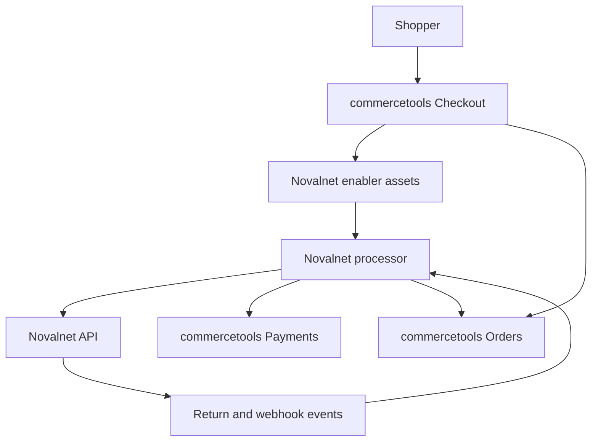

# Novalnet Payment Connector for commercetools

The <a href="https://www.novalnet.com/integration/novalnet-payment-connector-for-commercetools/"> **Novalnet Payment Connector** </a>  is a commercetools Connect application that integrates the Novalnet Payment Gateway with **commercetools Checkout**. It supports direct and redirect payment methods, authorization and payment flows, webhook processing, and automatic synchronization of Payments and Orders throughout the payment lifecycle.

The connector is built using the **commercetools Connect Payment SDK** and follows commercetools Connect deployment standards.

## Key features of commercetools Payment Connector integration
- Easy configuration for all payment methods
- One PCI DSS-certified payment platform for all payment services from checkout to collection
- One platform for all relevant payment types and related services
- Effortless configuration of risk management with fraud prevention
- 60+ risk & payment fraud detection modules to prevent defaults in real time 
- Clear overview of payment status from checkout to receivables
- Multilevel claims management with integrated handover to collection and various export functions for the accounting
- Comprehensive fraud prevention solution with more than 60 modules (Machine learning) 
- Reporting & analytics dashboards with multiple export options
-  Direct and Redirect payment flows 
- Credit Card 3D Secure support 
- One-click shopping enabled for commonly used payment types --
- On-hold transaction configuration for Credit Card, Direct Debit SEPA, Invoice , Guarantee Direct Debit Sepa ,Guarantee Invoice and PayPal --
- Allows merchants to configure a minimum transaction amount required to initiate payment authorization.
- Automatically validates whether a transaction meets the eligibility criteria for guaranteed payment processing.
- Supports webhook notifications and processing for major payment-related events 
- Enables deployment and integration of the payment module through the commercetools Connect platform.


For detailed documentation and other technical inquiries, please send us an email at <a href="mailto:sales@novalnet.de"> sales@novalnet.de </a>

## Integrated payment methods
- Direct Debit SEPA
- Direct Debit ACH
- Credit/Debit Cards 
- Invoice 
- Prepayment
- Invoice with payment guarantee
- Direct Debit SEPA with payment guarantee
- iDEAL | Wero
- Przelewy24
- eps
- PayPal
- MB Way
- PostFinance Card
- PostFinance E-Finance
- Bancontact
- Multibanco
- Online bank transfer
- Alipay
- WeChat Pay
- Trustly
- Blik
- Payconiq
- TWINT
- Pix                      
- Boleto                      
- Bizum 
- Bancomcat Pay               
- Kakao Pay                    
- Naver Pay                    

## commercetools Payment Connector Installation
Follow these steps to install the commercetools Payment Connector by Novalnet:

1. Log in to your <a href="https://identity.commercetools.com/"> commercetools Merchant Center </a>
2. Navigate to <a href="https://docs.commercetools.com/connect"> commercetools Connect </a> and install the Novalnet Connector.
3. Configure Product Activation Key and Payment access key in the shop admin panel
4. Enable & activate the preferred payment types in your shop admin panel


## Project Structure

```
.
├── enabler/
│   ├── src/
│   ├── test/
│   └── README.md
├── processor/
│   ├── src/
│   ├── test/
│   └── README.md
├── connect.yaml
├── docker-compose.yml
└── README.md
```
## The connect deployment configuration specifie in connect.yaml, the information needed to publish the application
```
deployAs:
  - name: enabler
    applicationType: assets
  - name: processor
    applicationType: service
    endpoint: /
    scripts:
      postDeploy: npm install && npm run connector:post-deploy
      preUndeploy: npm install && npm run connector:pre-undeploy
    configuration:
      standardConfiguration:
        - key: CTP_PROJECT_KEY
          description: "commercetools project key"
          required: true
        - key: CTP_CLIENT_ID
          description: "commercetools client ID with manage_payments, manage_orders, manage_types, view_sessions, view_api_clients, manage_checkout_payment_intents & introspect_oauth_tokens scopes"
          required: true
        - key: CTP_AUTH_URL
          description: "commercetools Auth URL Test"
          required: true
          default: "https://auth.europe-west1.gcp.commercetools.com"
        - key: CTP_API_URL
          description: "commercetools API URL Test"
          required: true
          default: "https://api.europe-west1.gcp.commercetools.com"
        - key: CTP_SESSION_URL
          description: "commercetools Session URL Test"
          required: true
          default: "https://session.europe-west1.gcp.commercetools.com"
        - key: CTP_JWKS_URL
          description: "JWKs url"
          required: true
          default: "https://mc-api.europe-west1.gcp.commercetools.com/.well-known/jwks.json"
        - key: CTP_JWT_ISSUER
          description: "JWT Issuer for jwt validation"
          required: true
          default: "https://mc-api.europe-west1.gcp.commercetools.com"
        - key: NOVALNET_PRODUCT_ACTIVATION_KEY
          description: Your product activation key is a unique token for merchant authentication and payment processing. Get your Product activation key from the Novalnet Admin Portal `:` Projects > Choose your project > API credentials > API Signature 
          required: true
        - key: NOVALNET_TARIFF_KEY
          description: Enter a Tariff ID to match the preferred tariff plan you created at the Novalnet Admin Portal for this project.
          required: true
        - key: NOVALNET_CLIENT_KEY
          description: The client key is a unique identifier linked to your Novalnet merchant account, required to authenticate client requests, render the secure payment form, and temporarily tokenize sensitive information.
          required: true
        - key: NOVALNET_WEBHOOK_TEST_MODE
          description: Use test mode to test Novalnet webhook. Switch to live mode before setting your shop live to block unauthorized calls from external parties. (1 = Test, 0 = Live)
          required: false
          default: "0"
        - key: MERCHANT_RETURN_URL
          description: Merchant return URL for payment completion
          required: false
      securedConfiguration:
        - key: NOVALNET_PAYMENT_ACCESS_KEY
          description: Your secret key used to encrypt the data to avoid user manipulation and fraud. Get your Payment access key from the Novalnet Admin Portal Projects > Choose your project > API credentials > Payment access key
          required: true
        - key: CTP_CLIENT_SECRET
          description: "commercetools client secret"
          required: true
```
Here, you can see the details about various variables in the configuration

* **CTP_PROJECT_KEY** : The key identifying the commercetools Composable Commerce project.
* **CTP_SCOPE** :	Defines the permissions and access rights granted to the commercetools client, including the API endpoints it can access and whether it has read or write permissions.
* **CTP_AUTH_URL** : The URL used to authenticate with the commercetools platform and generate the OAuth 2.0 access token required for API requests. Default: https://auth.europe-west1.gcp.commercetools.com.
* **CTP_API_URL** : The base URL for accessing the commercetools Composable Commerce API. Default: https://api.europe-west1.gcp.commercetools.com.
* **CTP_SESSION_URL** : The URL used to create sessions in the commercetools platform. The connector uses these sessions to exchange information between the enabler and processor. Default: https://session.europe-west1.gcp.commercetools.com.
* **CTP_CHECKOUT_URL** : The URL for the commercetools Checkout API. Required for checkout-related operations. Example: https://checkout.europe-west1.gcp.commercetools.com.
* **CTP_JWKS_URL** : The JSON Web Key Set (JWKS) URL used to retrieve public keys for validating JSON Web Tokens (JWTs). Default: https://mc-api.europe-west1.gcp.commercetools.com/.well-known/jwks.json.
* **CTP_JWT_ISSUER**	Specifies the expected issuer in the JSON Web Token (JWT), which is required during JWT validation. Default: https://mc-api.europe-west1.gcp.commercetools.com.
* **CTP_CLIENT_ID** : The client ID of your commercetools API client. It is used to authenticate the connector with the commercetools platform through the SDK. The required scopes include manage_payments, manage_orders, view_sessions, view_api_clients, manage_checkout_payment_intents, introspect_oauth_tokens, manage_types and view_types.
* **CTP_CLIENT_SECRET** : The client secret associated with your commercetools API client. It is used along with the client ID to authenticate requests to the commercetools platform through the SDK.
* **NOVALNET_PRODUCT_ACTIVATION_KEY** : A unique token used for merchant authentication and payment processing. Obtain it from the Novalnet Admin Portal under Projects > Select your project > API credentials > API Signature.
* **NOVALNET_TARIFF_KEY** : Specifies the Tariff ID associated with the preferred tariff plan configured in the Novalnet Admin Portal for the project.
* **NOVALNET_CLIENT_KEY** : A unique identifier linked to your Novalnet merchant account. It is used to authenticate client requests, render the secure payment form, and temporarily tokenize sensitive payment information.
* **NOVALNET_PAYMENT_ACCESS_KEY** : A secret key used to encrypt data and protect against data manipulation and fraudulent requests. Obtain it from the Novalnet Admin Portal under Projects > Select your project > API credentials > Payment access key.
* **NOVALNET_WEBHOOK_TEST_MODE** : Enables test mode for Novalnet webhook notifications. Set to 1 for test mode and 0 for live mode. Switch to live mode before making your shop live. Default: 0.
* **MERCHANT_RETURN_URL** : Specifies the merchant return URL to which customers are redirected after completing the payment process.

## Connector

### Enabler

The **Enabler** provides the frontend integration between commercetools Checkout and Novalnet's secure payment components.

Responsibilities include:

* Loading Novalnet payment libraries.
* Rendering secure payment forms.
* Initializing payment methods.
* Collecting payment data securely.
* Communicating with the Processor.

### Processor

The **Processor** is the backend middleware responsible for:

* Creating payments.
* Calling Novalnet APIs.
* Processing redirect callbacks.
* Handling webhooks.
* Updating commercetools Payments.

## Payment Flow

### Connector overview


Refer to **connect.yaml** for the complete configuration list.

## Documentation  
Find more about WooCommerce plugin in: 
[https://www.novalnet.de/site_pdf/commercetools-novalnet-payments-connector_Installation_guide.pdf](https://www.novalnet.de/site_pdf/commercetools-novalnet-payments-connector_Installation_guide.pdf)<br>

## Support
For more information about the integration, please get in touch with us at sales@novalnet.de or +49 89 9230683-20 or by contacting us <a href="https://www.novalnet.de/kontakt/sales"> here.</a>

Novalnet AG<br>
Zahlungsinstitut (ZAG)<br>
Gutenbergstraße 7<br>
D-85748 Garching<br>
Deutschland<br>
E-mail: sales@novalnet.de<br>
Tel: +49 89 9230683-20<br>
Web: www.novalnet.de

## Licenses

As a European Payment institution, Novalnet holds all necessary payment licenses to accept and process payments worldwide. We also comply with European data protection regulations to guarantee advanced data protection worldwide.

See here for [Freeware License Agreement](https://www.novalnet.com/payment-plugins-free-license/).	
